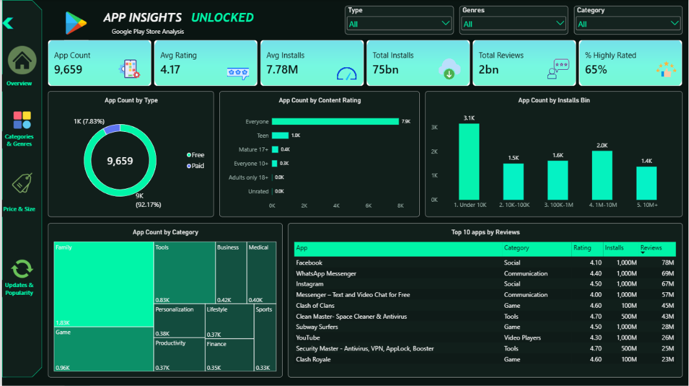
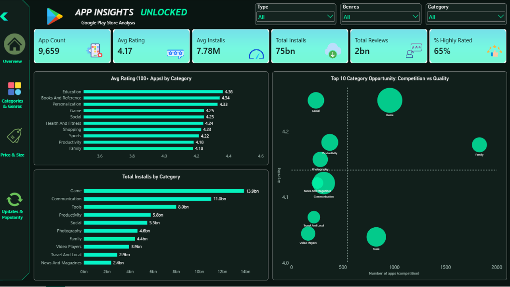
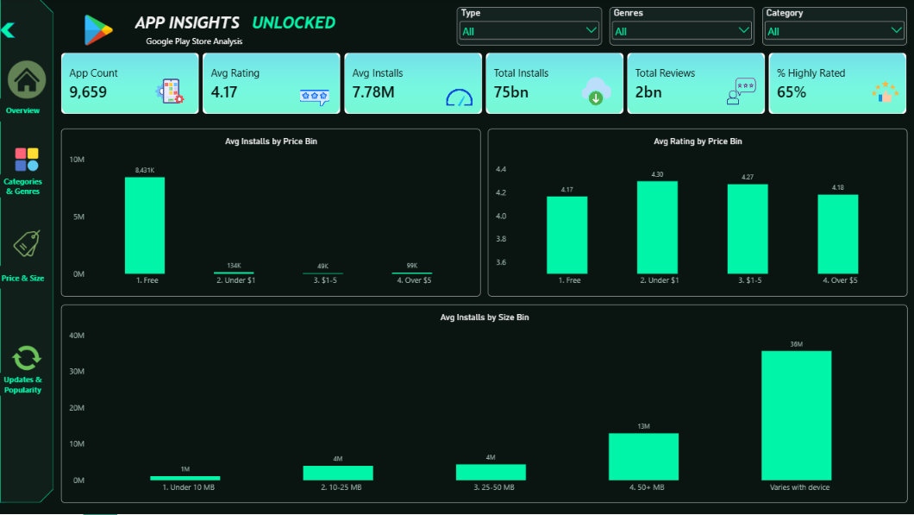
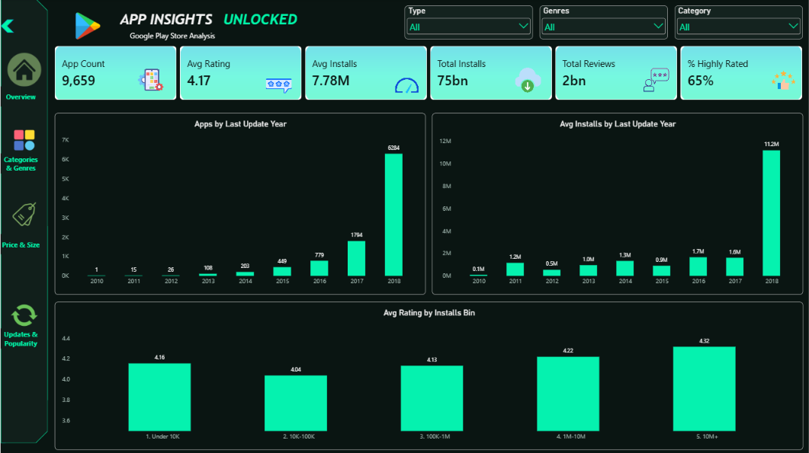

# App Insights Unlocked: Google Play Store Analysis (Power BI)

An interactive Power BI dashboard that finds what drives app success on the Google Play Store: ratings, installs, reviews, price, size and updates.

## Business problem
A mobile app company wants to know what makes an app succeed, so it can improve its development strategy, user experience, downloads and revenue. This project analyzes **9,659 unique apps** and answers a 25-question business brief (10 basic, 10 medium, 5 advanced).

## Key insights
| # | Insight | Action |
|---|---|---|
| 1 | **Demand is concentrated.** Five categories hold 58.8% of installs (Game 13.9bn, Communication 11.0bn, Tools 8.0bn) | Prioritize these for reach, and differentiate to cope with competition |
| 2 | **Quality is highest where competition is lighter.** Education (4.36), Books and Reference (4.34), Personalization (4.33) | Prefer underserved, high-rated niches |
| 3 | **Free wins adoption.** Free apps average 8.4M installs, against under 0.14M for any paid group | Launch free-first, monetize with ads or in-app purchases |
| 4 | **Bigger, fresher apps get more installs.** 50 MB+ apps average 12.9M, and 2018-updated apps 11.2M | Invest in features and update every 3 to 6 months |
| 5 | **Popularity does not guarantee quality.** Installs-rating correlation is 0.04, yet 10M+ install apps rate highest (4.32) | Treat quality and user acquisition as separate workstreams |

## Dashboard views
| View | Question it answers |
|---|---|
| Overview | What does the market look like? |
| Categories and Genres | Where are demand, quality and opportunity? |
| Price, Size and Type | Do price and size affect adoption and ratings? |
| Updates and Popularity | Are apps maintained, and do popular apps rate better? |

| | |
|---|---|
|  |  |
|  | |

## Data cleaning (Power Query)
- Removed 1 corrupted row and 1,181 duplicate apps (10,841 to 9,659 rows).
- Converted Rating NaN to true nulls instead of filling them.
- Fixed Price rounding caused by automatic type detection, so cents are kept.
- Converted Size from text to MB, and kept "Varies with device" as null.
- Standardized Category labels and kept the primary genre only (118 values reduced to 48).

## Model (DAX)
Measures: App Count, Avg Rating, Total Installs, Avg Installs, Total Reviews, % Highly Rated, Avg Rating (100+ Apps). Calculated columns: Installs Bin, Size Bin, Price Bin, Update Year.

## Questions coverage
- **20 of 25** answered in full.
- **4** answered with a stated workaround (B6, M6, A1, A2).
- **1** not answerable from this file (A4, sentiment analysis needs review text).

The full write-up, with every answer, insight and action, is in [`docs/App_Insights_Unlocked_Documentation.pdf`](docs/App_Insights_Unlocked_Documentation.pdf).

## Limitations
- Installs are brackets (for example 1,000,000+), so totals are lower-bound estimates.
- The data ends on 8 August 2018, so 2018 is a partial year.
- Each app has one last-update date, so update frequency is approximated.
- Findings show correlation, not proof of cause.

## Tools
Power BI, Power Query, DAX

## Dataset
[Google Play Store Apps on Kaggle](https://www.kaggle.com/datasets/lava18/google-play-store-apps) (`googleplaystore.csv`)

## How to open
Download the `.pbix` file and open it with Power BI Desktop (free).

## Author
**Md Ziaul Haque** | Data Analyst
[LinkedIn](#) | [Email](#)
